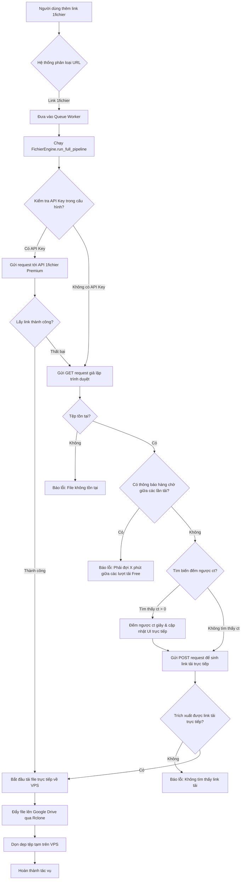

# 🎨 DESIGN: 1fichier Downloader Engine Integration

Ngày tạo: 2026-07-07
Dựa trên: [plan.md](file:///Volumes/Working%20Data/OneDrive_qmh/Personal%20Project/Coding/gdrivedl/rclone_web_ui/plans/260707-0032-1fichier-engine/plan.md)

---

## 1. Cách Lưu Thông Tin (Database / Cấu hình)

Hệ thống sẽ lưu trữ API Key của 1fichier trong một tệp cấu hình JSON riêng biệt để tránh ảnh hưởng đến các cấu hình khác:

### Tệp cấu hình: `fichier_config.json`
*   **Đường dẫn**: `/www/wwwroot/rclone.laboon.vn/github_config.json` (hoặc cùng thư mục chứa cấu hình chung trên VPS, cục bộ lưu tại thư mục gốc dự án).
*   **Cấu trúc dữ liệu**:
    ```json
    {
      "api_key": "Mã API Key Premium (nếu có)"
    }
    ```

---

## 2. Giao Diện & API Endpoints

### 2.1. API Endpoints mới trong `app.py`

#### 📡 API 1: Lấy thông tin cấu hình 1fichier
- **Endpoint**: `/api/fichier/config`
- **Method**: `GET`
- **Phản hồi (JSON)**:
  - Nếu đã cấu hình API Key: `{"has_api_key": true, "api_key_masked": "ab****yz", "complete": true}`
  - Nếu chưa cấu hình: `{"has_api_key": false, "api_key_masked": "", "complete": false}`

#### 📡 API 2: Lưu cấu hình 1fichier
- **Endpoint**: `/api/fichier/config`
- **Method**: `POST`
- **Yêu cầu (JSON)**: `{"api_key": "API_KEY_MOI"}` (Nếu gửi `"__KEEP__"` sẽ giữ nguyên API Key cũ).
- **Phản hồi (JSON)**: `{"success": true}` hoặc `{"error": "Thông điệp lỗi"}`

---

## 3. Luồng Hoạt Động & Xử lý thời gian chờ (Flowchart)

Đây là sơ đồ hoạt động khi người dùng thêm một link `1fichier.com` vào hàng đợi. Điểm đặc biệt là xử lý chế độ **Free** không cần tài khoản trả phí.



---

## 4. Checklist Kiểm Tra & Test Cases

Tất cả các chức năng phải vượt qua bộ kiểm thử dưới đây trước khi bàn giao:

━━━━━━━━━━━━━━━━━━━━━━━━━━━━━━━━━━━━━━━━━━━━━━━━━
### 🧪 TC-01: Tải với chế độ Free (Không cấu hình API Key)
━━━━━━━━━━━━━━━━━━━━━━━━━━━━━━━━━━━━━━━━━━━━━━━━━
*   **Given**: Hệ thống chưa lưu API Key 1fichier. Thư mục `/tmp/fichier_dl` trống.
*   **When**: Người dùng thêm link `https://1fichier.com/?3z71it1si6n2z2fwt8t1&af=2899507`.
*   **Then**:
    *   ✓ UI hiển thị trạng thái `1fichier API: Tự động (Free)`.
    *   ✓ Log hàng đợi bắt đầu đếm ngược từ 60 giây xuống 0 giây.
    *   ✓ File được tải về `/tmp/fichier_dl/...` dưới dạng `.part` rồi đổi thành file hoàn chỉnh.
    *   ✓ Rclone tải tệp lên Google Drive thành công.
    *   ✓ Thư mục tạm được dọn dẹp sạch sẽ sau khi hoàn thành.

━━━━━━━━━━━━━━━━━━━━━━━━━━━━━━━━━━━━━━━━━━━━━━━━━
### 🧪 TC-02: Kiểm tra trùng lặp tệp (Skip download)
━━━━━━━━━━━━━━━━━━━━━━━━━━━━━━━━━━━━━━━━━━━━━━━━━
*   **Given**: Tệp `Paw.Patrol.On.a.Roll_...rar` đã tồn tại trên đích đến Google Drive.
*   **When**: Thêm lại link 1fichier tương tự vào hàng đợi.
*   **Then**:
    *   ✓ Hệ thống kiểm tra dung lượng và tên file thông qua HEAD request trước.
    *   ✓ Phát hiện tệp đã tồn tại, lập tức ghi nhận `Completed` và skip tải mà không cần bắt người dùng chờ 60s hay tải lại.

━━━━━━━━━━━━━━━━━━━━━━━━━━━━━━━━━━━━━━━━━━━━━━━━━
### 🧪 TC-03: Xử lý giới hạn lượt tải Free (Rate Limit)
━━━━━━━━━━━━━━━━━━━━━━━━━━━━━━━━━━━━━━━━━━━━━━━━━
*   **Given**: Người dùng vừa tải xong 1 file từ 1fichier bằng IP hiện tại.
*   **When**: Thêm tiếp 1 link khác vào hàng đợi ngay lập tức.
*   **Then**:
    *   ✓ Hệ thống bắt được thông báo `You must wait X minutes...` từ 1fichier.
    *   ✓ Trả về thông báo lỗi trực quan: `Lỗi giới hạn 1fichier: Bạn phải chờ X phút mới có thể tải tiếp (tài khoản Free giới hạn thời gian giữa các lượt tải).`

━━━━━━━━━━━━━━━━━━━━━━━━━━━━━━━━━━━━━━━━━━━━━━━━━
### 🧪 TC-04: Dừng tải khẩn cấp (Stop Job)
━━━━━━━━━━━━━━━━━━━━━━━━━━━━━━━━━━━━━━━━━━━━━━━━━
*   **Given**: Đang trong quá trình đếm ngược hoặc đang tải file về VPS.
*   **When**: Người dùng bấm nút "Dừng tải" (Stop) trên giao diện.
*   **Then**:
    *   ✓ Luồng tải dừng ngay lập tức.
    *   ✓ Trạng thái đổi thành `stopped`.
    *   ✓ Xóa sạch các tệp `.part` hoặc thư mục tạm tương ứng để giải phóng dung lượng VPS.

---
*Tạo bởi AWF 2.1 - Design Phase*
